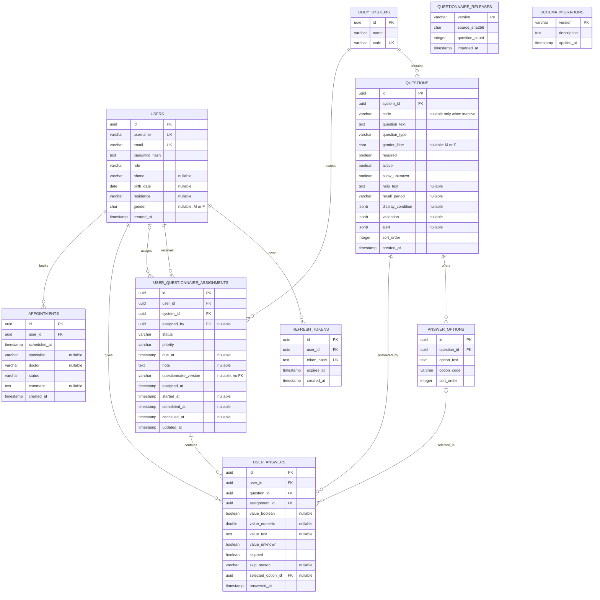

# ER-модель базы Immunolab

Диаграмма соответствует канонической PostgreSQL-схеме из `backend/schema.sql`.
Таблицы `schema_migrations` и `questionnaire_releases` являются независимыми
реестрами: текущая схема не задаёт для них внешних ключей.

## Составные связи и ограничения

- `(user_answers.assignment_id, user_answers.user_id)` ссылается на
  `(user_questionnaire_assignments.id, user_questionnaire_assignments.user_id)`.
  Ответ нельзя записать за другого пациента.
- `(user_answers.selected_option_id, user_answers.question_id)` ссылается на
  `(answer_options.id, answer_options.question_id)`. Вариант нельзя использовать
  для чужого вопроса.
- `(questions.system_id, questions.code)` уникально; у активного вопроса `code`
  не может быть `NULL`.
- `(answer_options.question_id, answer_options.option_code)` уникально.
- `user_answers_payload_check` допускает ровно одно значение, явное «не знаю»
  либо явный пропуск с причиной.
- `assignments_lifecycle_check` согласует статус назначения с датами начала,
  завершения и отмены.
- Уникальный индекс `(assignment_id, question_id, selected_option_id) NULLS NOT
  DISTINCT` предотвращает дубли ответов и одновременно допускает несколько
  разных вариантов для `multiple_choice`.

## Удаление связанных данных

- Удаление пользователя каскадно удаляет его токены, назначения, ответы и записи
  на приём.
- Удаление системы каскадно удаляет вопросы; назначения блокируют удаление
  используемой системы, поскольку для их FK не задан `ON DELETE`.
- Удаление вопроса каскадно удаляет варианты и ответы.
- Удаление назначения каскадно удаляет его ответы.
- Используемый вариант ответа нельзя удалить (`ON DELETE RESTRICT`).
